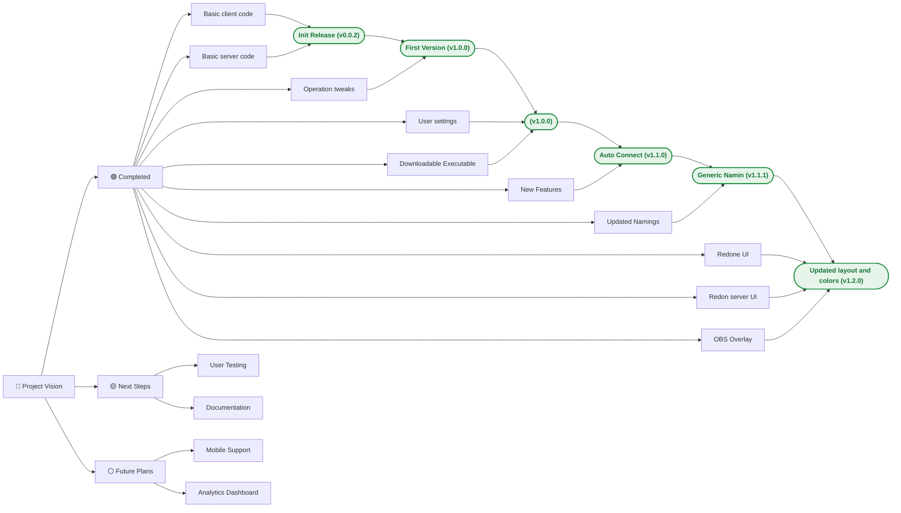

# Project Roadmap

> **Vision:** Create a system to detect, stream, record and present live heartrate data for livestreaming purposes  
> **Status Legend:** 🟢 Completed | 🟡 Planned | ⚪ Backlog 
---
# Roadmap Overview

---
## 🎯 Core Goals
- **Goal 1:** [Primary outcome or metric — e.g., Ship a usable core workflow]
- **Goal 2:** [Secondary outcome or metric — e.g., Validate with early users]
- **Goal 3:** [Quality or reliability target — e.g., Full documentation and stable release]

---
## Future of the Development

### 🟡 Next Steps
- [ ] Test with mnore devices
- [ ] Update the readme with install/use manual
- [ ] hjdsjkfj

### ⚪ Future Plans
- [ ] Make "Help" buttons in the client program for help features/tutorials

---

## ⚠️ Risks & Mitigations

| Risk | Impact | Mitigation |
| :--- | :--- | :--- |
| Scope creep during core build | High | Freeze MVP scope until Milestone 1 ships |
| External dependencies | Medium | Build mock endpoints so work can proceed in parallel |
