# Project Roadmap

> **Vision:** Create a system to detect, stream, record and present live heartrate data for livestreaming purposes  
> **Status Legend:** 🟢 Completed | 🟡 Planned | ⚪ Backlog 
---
# Roadmap Overview

```mermaid
graph LR
    Root["🎯 Project Vision"]
    
    subgraph helper1[" "]
        Root --> Completed["🟢 Completed"]
        Root --> Next["🟡 Next Steps"]
        Root --> Future["⚪ Future Plans"]
    end

    %% Completed Plans
    Completed --> comp1["Basic client code"]
    Completed --> comp2["Basic server code"]
    comp1 & comp2 --> M1(["Init Release (v0.0.2)"]):::doneMilestone

    Completed --> comp3["Operation tweaks"]
    M1 & comp3 --> M2(["First Version (v1.0.0)"]):::doneMilestone

    Completed --> comp4["User settings"]
    Completed --> comp5["Downloadable Executable"]
    comp4 & comp5 --> M3(["USer settings (v1.1.0)"]):::doneMilestone

    Completed --> comp6["Updated Namings"]
    M3 & comp6 --> M4(["Generic Naming (v1.1.1)"]):::doneMilestone

    Completed --> comp7["Redone UI"]
    Completed --> comp8["Redon server UI"]
    Completed --> comp9["OBS Overlay"]
    M4 & comp7 & comp8 & comp9 --> M5(["Updated layout and colors (v1.2.0)"]):::doneMilestone

    Completed --> comp10["Updated scan and connection logic"]
    Completed --> comp11["Improved backend logic"]
    Completed --> comp12["Better discovery"]
    Completed --> comp13["Improved timings"]
    M5 & comp10 & comp11 & comp12 & comp13 --> M6(["Improved Performance (v1.3.0)"]):::doneMilestone

    Completed --> comp14["Fixed release.yml"]
    M6 & comp14 --> M7(["Fixed yml (v1.3.1)"]):::doneMilestone

    Completed --> comp15["Updated Roadmap"]
    M7 & comp15 --> M8(["Roadmap Update (v1.3.2)"]):::doneMilestone


    %% Next branch
    Next --> next1["User Testing"]
    M8 & next1 --> M200(["Next Version (v2.0.0)"]):::doneMilestone

    %% Future Plans branch
    Future --> future1["Mobile Support"]
    Future --> future2["Analytics Dashboard"]

    %% Hide the subgraph outline, background, and text
    style helper1 fill:none,stroke:none,color:transparent

    %% Milestone Styles
    classDef doneMilestone fill:#e6f4ea,stroke:#1e8e3e,stroke-width:2px,color:#137333,font-weight:bold
    classDef nextMilestone fill:#fef7e0,stroke:#f9ab00,stroke-width:3px,color:#b06000,font-weight:bold
    classDef futureMilestone fill:#e8f0fe,stroke:#1a73e8,stroke-width:3px,color:#174ea6,font-weight:bold
```

---
## 🎯 Core Goals
- **Goal 1:** Make a system for detecting heartrate using off the shelf heartrate trackers
- **Goal 2:** Have users be able to use different operating systems to use the system
- **Goal 3:** Have a system of showing the heartrate on a livestream

---
## Future of the Development

### 🟡 Next Steps
- [ ] Make connecting the device easier
- [ ] Test with more and different devices
- [ ] Update the readme with install/use manual
- [ ] Add configurable positions of users on the overlay/server interface
- [ ] add a wway to download the uploaded sessions from the server (dropdown for format?)
- [ ] toggle record from the server side in addition to client side

### ⚪ Future Plans
- [ ] Make "Help" buttons in the client program for help features/tutorials
- [ ] add a 'analyse' button where you can analyse recorded sessions
- [ ] make it work with many different devices

---

## ⚠️ Risks & Mitigations

| Risk | Impact | Mitigation |
| :--- | :--- | :--- |
| Scope creep during core build | High | Freeze MVP scope until Milestone 1 ships |
| External dependencies | Medium | Build mock endpoints so work can proceed in parallel |
